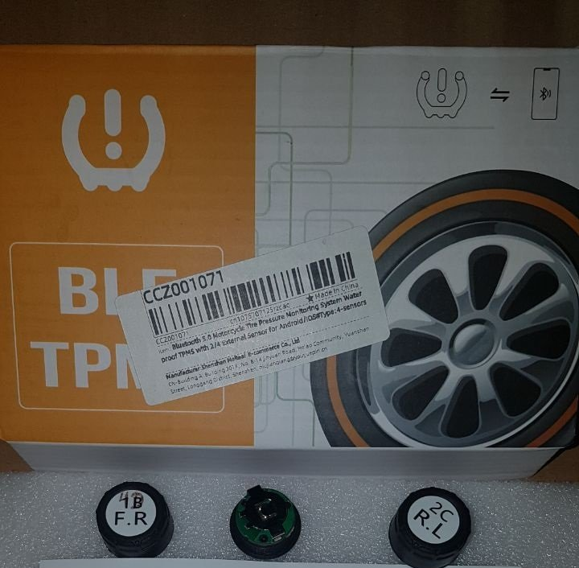

# TPMS_BLE
Integrates Bluetooth LE to Home Assistant using passive connection to get infromation from the sensors.

Exposes the following sensors:
 - Battery
 - Pressure
 - Temperature
 - Voltage
 - Data Age (minutes since last BLE update)

## Installation

Easiest install is via [HACS](https://hacs.xyz/):

`HACS -> Explore & Add Repositories -> TPMS_BLE`

The device will be autodiscovered once the data are received by any bluetooth proxy.

## Supported Devices
### Type A
Android App: [TPMSII](https://play.google.com/store/apps/details?id=com.chaoyue.tyed) 

Product Link: [AliExpress](https://www.aliexpress.com/item/1005006129840804.html)

### Type B
Android App: [SYTPMS](https://play.google.com/store/apps/details?id=com.bekubee.sytpms)

Product Link: [AliExpress](https://www.aliexpress.com/item/1005006755884183.html)

### Type C (Michelin TMS)
Product Description: [Michelin](https://www.michelin.co.uk/auto/advice/tyre-pressure/tpms-tyre-pressure-monitoring-system)

### Type D (WODHMIEY / ITPMS K)

Android Apps: [ITPMS (K)](https://play.google.com/store/apps/details?id=com.zl.dev.tire.itpms),[LYTPMS](https://play.google.com/store/apps/details?id=com.zl.dev.tire.lytpms)

Product Link: [WODHMIEY](https://www.amazon.de/-/en/WODHMIEY-Monitoring-Motorcycle-Temperature-Motorhome/dp/B0GWH88YSV)

### Type E (Salutica FOBO TPMS)

Android Apps: [FOBO TPMS](https://play.google.com/store/apps/details?id=my.com.salutica.fobotpms)

Product Description: [FOBO](https://my-fobo.com/)

### Type F (bekubee HRTPMS)

Android Apps: [HRTPMS](https://play.google.com/store/apps/details?id=com.bekubee.hrtpms)

Product Description: [AotuLink](https://aotu-link.com/)

Product Link: [AliExpress](https://www.aliexpress.com/item/1005013168188255.html)

### Type G (Ai TPMS AI-8000)

Android App: „Ai TPMS"

Product: [AliExpress, BLE TPMS AI-8000](https://www.aliexpress.com/item/1005009771707179.html) (listing may no longer be available; look for "Ai TPMS" BLE sensors, app "Ai TPMS")

Bluetooth name `AI-*`, addresses `12:30:AF:…`. Detection is by name and
address, **not** by the manufacturer id — the sensor writes its
measurements INTO it, so the id is part of the data.

Frame (5 bytes: manufacturer id little-endian + payload), worked out from
captures of four sensors (2026-10-16):

| byte | meaning |
|---|---|
| 0 | status bits 0–3 (rotate between messages, meaning unknown) |
| 1 | battery, voltage × 10 |
| 2 | temperature °C |
| 3–4 | pressure, big-endian, 0.1 psi **absolute** — gauge = raw/10 − 14.696 psi |

The captured frames: `0x0092` (no overpressure, ambient air) and `0x01AE`
(a mounted tyre, 1.951 bar gauge; the car's factory TPMS sensor on the
same wheel showed 1.944 bar).

